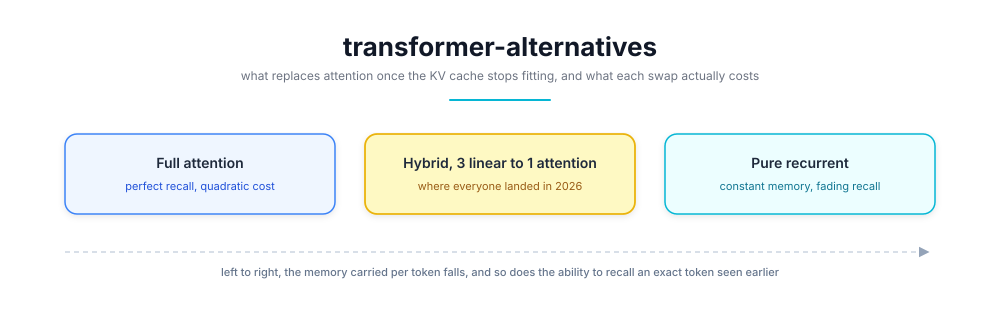
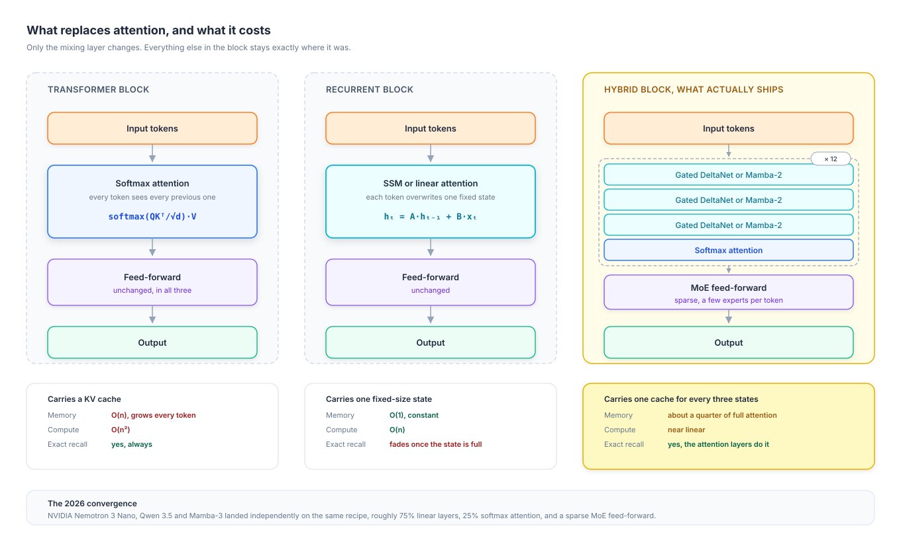
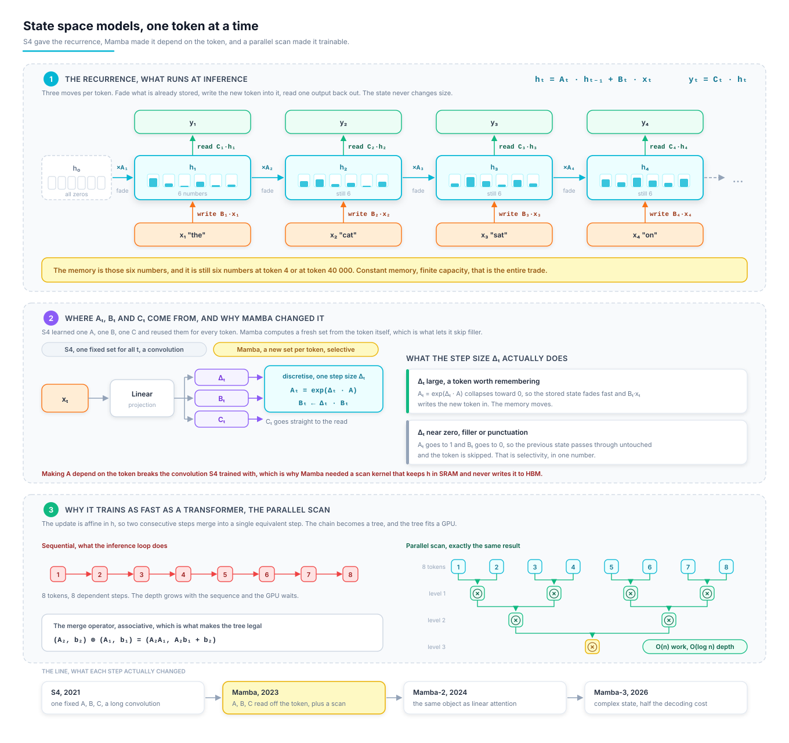
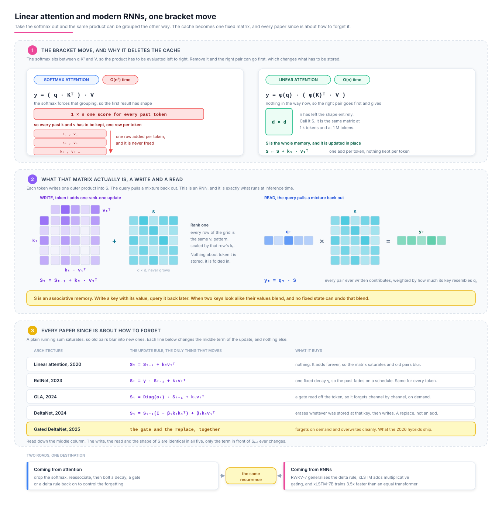
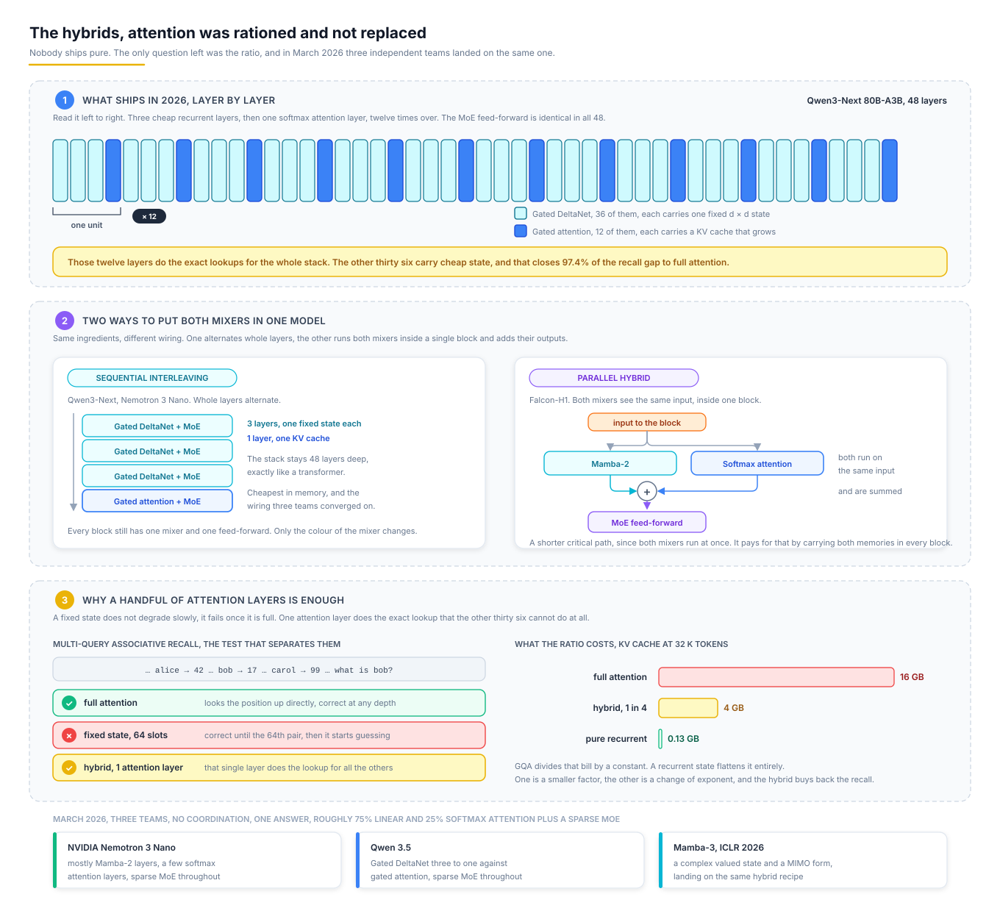
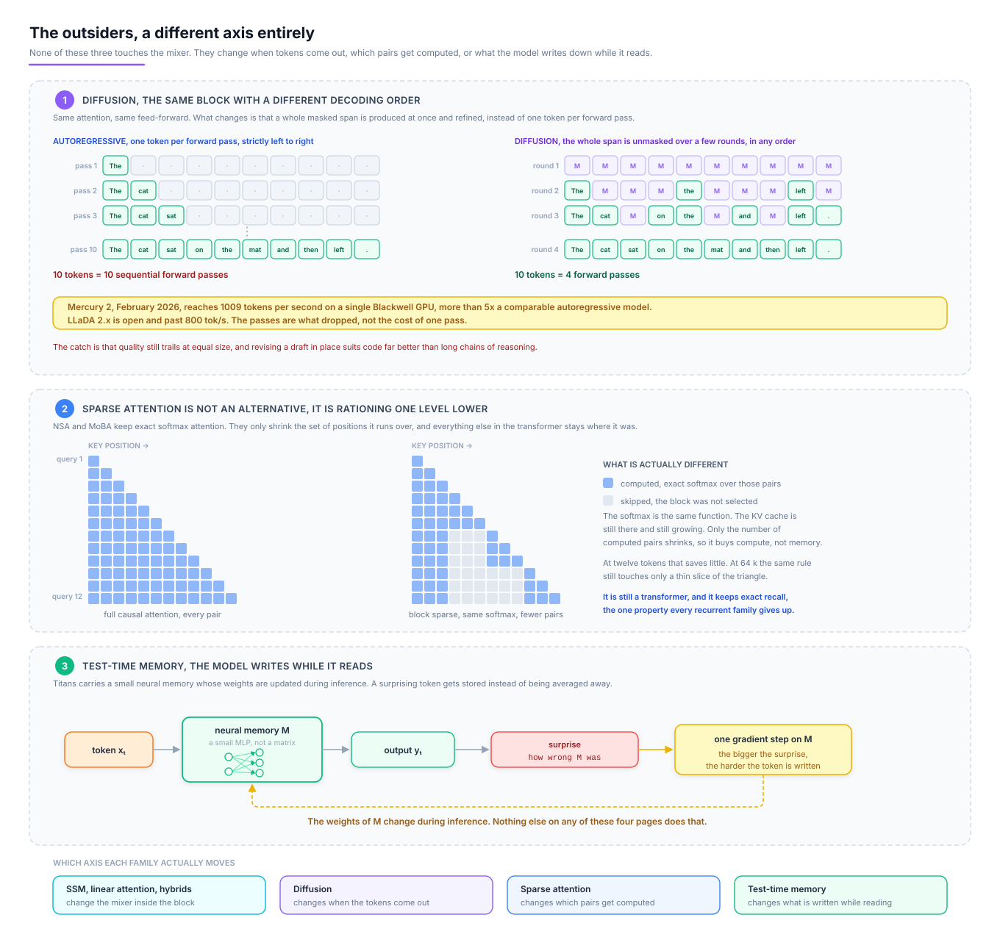

# 🌊 transformer-alternatives


<p align="center">
  
</p>

---

## 📝 Project Description

Attention is not being replaced because it works badly. It is being replaced because **it remembers by keeping everything**. Every token generated adds a row to a KV cache that never shrinks, so memory grows with context and compute grows with its square.

Every alternative here makes the same trade. **Replace a cache that grows with a state that does not**, and accept that a fixed state eventually forgets. These learning notes are the third of a series, after [Original LLM](https://github.com/Thibault-GAREL/Language_Models) (the 2017 Transformer) and [Modern LLM](https://github.com/Thibault-GAREL/LLMs_modern_from_scratch) (everything that changed **inside** it).

---

## 📊 The bill and the price

| Context | Attention, plain MHA | Attention, GQA at 8 kv heads | Mamba-2 state |
|---|---|---|---|
| 1 k tokens | 0.5 GB | 0.13 GB | 0.13 GB |
| 8 k tokens | 4 GB | 1 GB | 0.13 GB |
| 32 k tokens | 16 GB | 4 GB | 0.13 GB |
| 128 k tokens | 64 GB | 16 GB | 0.13 GB |

**The bill**, for a 7B model with 32 layers. Read the last column, it never moves. **GQA divides the bill, a recurrent state flattens it.**

```
prompt   "... alice -> 42 ...  bob -> 17 ...  carol -> 99 ...   what is bob?"

full attention          looks the position up directly, correct at any depth
fixed state, 64 slots   correct until the 64th pair, then it starts guessing
hybrid, 1 attention     correct, that single layer does the lookup for the others
```

**The price**, measured by Multi-Query Associative Recall (MQAR). A fixed state does not degrade gracefully, it fails **once it is full**.

<details>
<summary>📐 <b>Why a constant factor is not enough</b></summary>

GQA is a constant factor, a recurrent state is a change of exponent, and that difference is the entire argument. On a 6 GB card the practical consequence is blunt: at 32 k tokens the KV cache alone leaves no room for the weights it belongs to.

</details>

<details>
<summary>🧱 <b>Why a full state cannot be trained away</b></summary>

Once the state is full, everything written after overwrites something written before, and no amount of training fixes a capacity limit. This is why pure recurrent models look excellent on perplexity and disappoint on "find the one line in this file".

</details>

<details>
<summary>📈 <b>Why perplexity hides the problem</b></summary>

Averaged over a corpus, forgetting one rare token costs almost nothing. Zoology pinned the number down, **82% of the perplexity gap** between attention-free models and attention comes from recall alone, which is why MQAR became the standard probe.

</details>

<details>
<summary>⚖️ <b>Nobody ships pure</b></summary>

Every serious 2026 release keeps some softmax attention. The question stopped being *whether* to keep it and became *how little* is enough.

</details>

---

## 🗺️ How it works



Three blocks, one difference. The left keeps every token, the middle keeps one state, the right keeps one cache for every three states. The four families below fill in that middle and right column.

---

## 1️⃣ State space models

**A recurrence borrowed from control theory, made trainable in parallel.**



> **Selectivity is the whole idea.** A fixed `A` filters every token the same way, which is a convolution wearing a costume. Making it input-dependent is what turned a nice long-range model into a language model.

<details>
<summary>📄 <b>Code · the recurrence and the parallel scan</b></summary>

```python
# What runs at inference, one token at a time. h is the entire memory.
for t in range(seq_len):
    h = A[t] * h + B[t] * x[t]
    y[t] = C[t] @ h

# The same maths at training time. This is the breakthrough, not the recurrence.
y = associative_scan(A, B, C, x)   # O(n) work, O(log n) depth on a GPU
```

</details>

<details>
<summary>🕰️ <b>From S4 to Mamba-3</b></summary>

**S4 came from signal processing**, not from language. A structured state matrix plus a discretisation step turns a continuous system into something that handles 16 k tokens without attention.

**Mamba made `A`, `B` and `C` depend on the input.** That selectivity is what lets it skip filler and keep what matters. It broke the convolutional shortcut, so the answer was a hardware-aware scan that never writes the state to HBM.

**Mamba-2 proved SSMs and linear attention are the same object** (state space duality), which unlocked plain matmul kernels. **Mamba-3** (ICLR 2026) adds a complex-valued state update for richer state tracking and a MIMO form, matching strong baselines at **half the decoding cost**.

</details>

---

## 2️⃣ Linear attention and modern RNNs

**Drop the softmax and the algebra reassociates, which is all it takes.**



> **Two roads, one destination.** One camp removed the softmax from attention, the other fixed the RNN so it trains in parallel. They met in the middle, and the modern papers are barely distinguishable.

<details>
<summary>📄 <b>The bracket move, in two lines</b></summary>

```
attention          softmax(q · kᵀ) · v          the softmax blocks reassociation, so O(n²)

linear attention   (φ(q) · φ(k)ᵀ) · v
                 = φ(q) · (φ(k)ᵀ · v)           one fixed d × d matrix S, carried forward
                            └─ a running sum, updated per token
```

`kᵀv` becomes a running sum instead of a matrix to rebuild, so the model is an RNN at inference and a parallel scan at training, with no cache in sight.

</details>

<details>
<summary>🚪 <b>How each model forgets</b></summary>

A plain sum saturates, so everything since is about forgetting. RetNet added a fixed exponential decay, GLA a data-dependent gate, and DeltaNet a write rule that **replaces** an association instead of adding to it. Gated DeltaNet combines both and is what most 2026 hybrids actually use.

</details>

<details>
<summary>🐦 <b>RWKV and xLSTM, from the RNN side</b></summary>

They arrive from the other camp and land in the same place. RWKV-7 generalises the delta rule, and xLSTM-7B trains **3.5x faster** than a transformer of equal size through multiplicative gating.

</details>

---

## 3️⃣ The hybrids

**Nobody ships pure. The interesting question is the ratio.**



> **Attention was not replaced, it was rationed.** The 2026 architecture is a transformer that pays for full attention only where full attention actually earns its cost.

<details>
<summary>📄 <b>Qwen3-Next, layer by layer</b></summary>

```
Qwen3-Next 80B-A3B, 48 layers

  ┌ Gated DeltaNet ┐
  │ Gated DeltaNet │  × 12   →   36 linear layers, 12 attention layers
  │ Gated DeltaNet │             MoE feed-forward throughout
  └ Gated attention┘
```

Those twelve attention layers do the exact lookups, the other thirty-six carry cheap state. Zoology measured hybrids closing **97.4% of the gap** to full attention while keeping sub-quadratic scaling, and cache memory drops to roughly a quarter.

</details>

<details>
<summary>🔀 <b>Two ways to mix</b></summary>

Sequential interleaving (Qwen3-Next, Nemotron) alternates layers. Parallel hybrids (Falcon-H1) run Mamba-2 and attention **side by side in the same block** and sum them, which trades memory for a shorter critical path.

</details>

<details>
<summary>🎯 <b>How March 2026 settled it</b></summary>

NVIDIA Nemotron 3 Nano, Qwen 3.5 and Mamba-3 landed independently on the same recipe, roughly **75% linear, 25% attention, plus a sparse MoE**. Three teams, no coordination, one answer.

</details>

---

## 4️⃣ The outsiders

**Different axis entirely, these change when tokens are produced, not how they mix.**



<details>
<summary>🌫️ <b>Diffusion language models</b></summary>

```
autoregressive   one token per forward pass, left to right     n passes for n tokens
diffusion        a whole masked passage, refined in k rounds   k passes, k far below n
```

They shipped. Mercury 2 (February 2026) reaches **1009 tokens per second** on a single Blackwell GPU, over 5x comparable autoregressive models, and LLaDA 2.x is open and past 800 tok/s. The catch is that quality still trails at equal size, and editing a draft in place fits code better than long reasoning.

</details>

<details>
<summary>🕳️ <b>Why sparse attention is not an alternative</b></summary>

NSA and MoBA keep exact softmax attention and simply compute it over selected blocks. It is rationing again, one level lower, and it stays inside the transformer.

</details>

<details>
<summary>🧠 <b>Test-time memory</b></summary>

Titans keeps a small neural memory updated while it reads, so surprising tokens get stored rather than averaged away. Closer to giving the model a notebook than to changing its mixer.

</details>

---

## 🧠 What actually decides, in five lines

1. **The cache is the problem**, not the attention. Every alternative is an answer to a memory bill.
2. **A fixed state is a capacity, not a compression.** It does not degrade slowly, it fails once full.
3. **Parallel training was the unlock.** A recurrence nobody can train in parallel is a research curiosity.
4. **Perplexity will not show you the difference.** Retrieval will, which is why MQAR exists.
5. **The answer was a ratio.** Keep the attention you need, replace the rest, and that number turned out to be about one in four.

---

## 📖 Inspiration / Sources

This project is a study, so the sources matter more than usual:

- [Mamba, Linear-Time Sequence Modeling with Selective State Spaces](https://arxiv.org/abs/2312.00752) (Gu and Dao, 2023)
- [Transformers are SSMs, state space duality](https://arxiv.org/abs/2405.21060) (Dao and Gu, 2024), the paper that unified the two camps
- [Mamba-3, Improved Sequence Modeling using State Space Principles](https://arxiv.org/abs/2603.15569) (ICLR 2026)
- [Simple linear attention language models balance the recall-throughput tradeoff](https://arxiv.org/abs/2402.18668) (Arora et al., 2024), where MQAR comes from
- [xLSTM, Extended Long Short-Term Memory](https://arxiv.org/abs/2405.04517) (Beck et al., 2024)
- [RWKV, Reinventing RNNs for the Transformer Era](https://arxiv.org/abs/2305.13048) (Peng et al., 2023)
- [Zoology, Measuring and Improving Recall in Efficient Language Models](https://arxiv.org/abs/2312.04927) (Arora et al., 2023), the analysis that made the recall gap measurable
- [Original LLM](https://github.com/Thibault-GAREL/Language_Models) (where the series starts, a bigram model and a 2017 Transformer)
- [Modern LLM](https://github.com/Thibault-GAREL/LLMs_modern_from_scratch) (my own model, everything that changed inside the block)
- [llm-harness](https://github.com/Thibault-GAREL/LLM_harness) (my other learning notes, the agent loop that runs a trained model)

Notes written by me 😎, Thibault GAREL - [Github](https://github.com/Thibault-GAREL)
